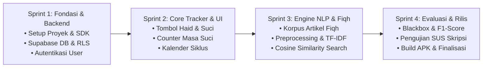

# Development Plan & Actionable Task Breakdown: "mySiklus"
**Target Proyek:** Aplikasi Mobile Asisten Pencatatan Masa Suci & Temu Kembali Panduan Fiqh Darah Wanita  
**Metodologi:** Agile / Scrum (4 Sprint @ 2 Minggu)  
**Dokumen Pendukung:** [DOKUMEN_RENCANA_PENGEMBANGAN_MYSIKLUS.md](file:///c:/Users/user/Documents/semester%207/mySiklus/DOKUMEN_RENCANA_PENGEMBANGAN_MYSIKLUS.md)

---

## 1. Daftar Teknologi yang Digunakan (Tech Stack & Architecture)

Pemilihan tumpukan teknologi didasarkan pada kebutuhan aplikasi seluler modern yang responsif, terisolasi secara keamanan data pribadi, dan mendukung algoritma *Information Retrieval* (IR/NLP) yang dapat dijalankan secara cepat dan mandiri (*offline-first*):

| Lapisan / Layer | Teknologi / Pustaka | Versi | Peran & Rationale Arsitektural |
| :--- | :--- | :---: | :--- |
| **Framework Mobile** | **Flutter (Dart SDK)** | `^3.0.0` | Memungkinkan pengembangan aplikasi *cross-platform* (Android & iOS) dengan performa tinggi (*native compile* 60/120 fps) dari satu basis kode. |
| **Pola Arsitektur** | **Clean Feature-First Architecture** | - | Memisahkan kode per modul fitur (`auth`, `cycle`, `fiqh`) ke dalam sub-layer `data`, `domain/nlp`, dan `presentation` agar *testable* dan mudah dikelola. |
| **State Management** | **Flutter Riverpod** | `^2.5.1` | Mengelola reaktivitas data aplikasi (*state*) secara terpusat, aman pada saat *compile-time*, tanpa ketergantungan `BuildContext`, untuk transisi status Haid ↔ Suci tanpa lag. |
| **Backend as a Service** | **Supabase (PostgreSQL)** | `^2.5.6` | Layanan *Backend-as-a-Service* (BaaS) berbasis PostgreSQL open-source, menyediakan database relasional tangguh, API REST instan, dan Supabase Auth bawaan. |
| **Keamanan Data** | **Row Level Security (RLS)** | Native PG | Protokol keamanan granular pada PostgreSQL untuk memastikan data siklus biologis dan histori pencarian terisolasi absolut antar pengguna (*privacy-first*). |
| **Mesin NLP / IR** | **TF-IDF & Cosine Similarity** | Dart Native | Algoritma *Vector Space Model* mandiri di sisi klien untuk mengubah kueri keluhan pengguna menjadi vektor bobot kata dan mencocokkannya dengan korpus literatur Fiqh. |
| **Pra-pemrosesan Teks** | **TextPreprocessor (Dart)** | Kustom | Modul pembersih teks bahasa Indonesia: *Case Folding*, *Punctuation Stripper*, *Stopwords Filter*, dan *Stemming* pemotong imbuhan dasar. |
| **UI & Kalender** | **TableCalendar** | `^3.1.2` | Komponen kalender interaktif yang dikustomisasi dengan *cell builder* multi-warna (Merah Muda Lembut untuk Haid dan Hijau Daun untuk Masa Suci). |
| **Tipografi & Desain** | **Google Fonts (Plus Jakarta Sans)** | `^6.2.1` | Tipografi modern elegan yang dipadukan dengan palet warna bernuansa feminin (*Dusty Rose*, *Sage Green*, *Soft Mauve*, dan *Cream Background*). |
| **Persistensi Lokal** | **SharedPreferences** | `^2.2.3` | Menyimpan preferensi pengguna, status sesi login lokal, dan *flag* penggunaan mode tamu (*guest mode*). |
| **Format & Lokalisasi** | **Intl** | `^0.19.0` | Format penanggalan dan lokalisasi bahasa Indonesia baku (`id_ID`) untuk tanggal kalender dan riwayat siklus. |

---

## 2. Ikhtisar Alur Pengembangan (Roadmap)

---

## 3. Sprint 1: Fondasi Proyek, Database Supabase, & Autentikasi (Minggu 1 - 2)
> **Fokus Utama:** Menyiapkan *environment*, inisialisasi basis data dengan isolasi keamanan (*Row Level Security*), serta modul otentikasi pengguna.

| ID Task | Nama Task | Prioritas | Estimasi | Status | File Tautan |
| :--- | :--- | :---: | :---: | :---: | :--- |
| **TSK-101** | Setup Environment & Verifikasi Flutter SDK | High | 1 Hari | `[ ]` | Panduan PATH |
| **TSK-102** | Inisialisasi Proyek Mobile & Arsitektur Clean Architecture | High | 1 Hari | `[x]` Selesai | [pubspec.yaml](file:///c:/Users/user/Documents/semester%207/mySiklus/pubspec.yaml) |
| **TSK-103** | Konfigurasi Proyek Supabase BaaS & Service Wrapper | High | 1 Hari | `[x]` Selesai | [supabase_service.dart](file:///c:/Users/user/Documents/semester%207/mySiklus/lib/core/services/supabase_service.dart) |
| **TSK-104** | Eksekusi Migrasi Skema Basis Data & Konfigurasi RLS | High | 1 Hari | `[x]` Selesai | [001_initial_schema.sql](file:///c:/Users/user/Documents/semester%207/mySiklus/supabase/migrations/001_initial_schema.sql) |
| **TSK-105** | Implementasi Fitur Register & Login (Supabase Auth) | High | 2 Hari | `[x]` Selesai | [auth_provider.dart](file:///c:/Users/user/Documents/semester%207/mySiklus/lib/features/auth/presentation/providers/auth_provider.dart) |
| **TSK-106** | Setup Sesi Lokal & Offline Guest Mode | Medium | 1 Hari | `[x]` Selesai | [user_model.dart](file:///c:/Users/user/Documents/semester%207/mySiklus/lib/features/auth/data/models/user_model.dart) |
| **TSK-107** | Design System Dasar (Tema Warna, Tipografi, Reusable Widgets) | Medium | 2 Hari | `[x]` Selesai | [app_colors.dart](file:///c:/Users/user/Documents/semester%207/mySiklus/lib/core/constants/app_colors.dart), [app_theme.dart](file:///c:/Users/user/Documents/semester%207/mySiklus/lib/core/theme/app_theme.dart) |

---

## 4. Sprint 2: Core Tracker Masa Suci & Visualisasi Kalender (Minggu 3 - 4)
> **Fokus Utama:** Membangun pencatatan empiris siklus haid, *counter* masa suci *real-time*, dan kalender interaktif.

| ID Task | Nama Task | Prioritas | Estimasi | Status | File Tautan |
| :--- | :--- | :---: | :---: | :---: | :--- |
| **TSK-201** | Model Data Siklus (`CycleModel`) & Helper Logika Durasi | High | 2 Hari | `[x]` Selesai | [cycle_model.dart](file:///c:/Users/user/Documents/semester%207/mySiklus/lib/features/cycle/data/models/cycle_model.dart) |
| **TSK-202** | State Management Siklus (Riverpod `CycleNotifier`) | High | 2 Hari | `[x]` Selesai | [cycle_provider.dart](file:///c:/Users/user/Documents/semester%207/mySiklus/lib/features/cycle/presentation/providers/cycle_provider.dart) |
| **TSK-203** | UI Dashboard: Status Aktif Hari Ini & Tombol Interaktif | High | 2 Hari | `[x]` Selesai | [dashboard_screen.dart](file:///c:/Users/user/Documents/semester%207/mySiklus/lib/features/cycle/presentation/screens/dashboard_screen.dart) |
| **TSK-204** | Logika Algoritmik Counter Masa Suci (Ambang 15 Hari Fiqh) | High | 1 Hari | `[x]` Selesai | [dashboard_screen.dart](file:///c:/Users/user/Documents/semester%207/mySiklus/lib/features/cycle/presentation/screens/dashboard_screen.dart) |
| **TSK-205** | Integrasi `table_calendar` dengan Visual Multi-Warna | High | 2 Hari | `[x]` Selesai | [calendar_screen.dart](file:///c:/Users/user/Documents/semester%207/mySiklus/lib/features/cycle/presentation/screens/calendar_screen.dart) |
| **TSK-206** | Halaman Statistik Siklus & Riwayat Durasi Haid | Medium | 2 Hari | `[x]` Selesai | [dashboard_screen.dart](file:///c:/Users/user/Documents/semester%207/mySiklus/lib/features/cycle/presentation/screens/dashboard_screen.dart) |
| **TSK-207** | Validasi Input Logika Fiqh (Anti-tumpang tindih tanggal) | Medium | 1 Hari | `[x]` Selesai | [cycle_provider.dart](file:///c:/Users/user/Documents/semester%207/mySiklus/lib/features/cycle/presentation/providers/cycle_provider.dart) |

---

## 5. Sprint 3: Kurasi Korpus Fiqh & Mesin Pencari NLP (Minggu 5 - 6)
> **Fokus Utama:** Membangun pangkalan pengetahuan literatur fiqh wanita terkurasi dan menerapkan algoritma temu kembali informasi (TF-IDF & Cosine Similarity).

| ID Task | Nama Task | Prioritas | Estimasi | Status | File Tautan |
| :--- | :--- | :---: | :---: | :---: | :--- |
| **TSK-301** | Penyusunan Korpus 12 Artikel Fiqh Inti (Mazhab Syafi'i) | High | 3 Hari | `[x]` Selesai | [default_fiqh_corpus.dart](file:///c:/Users/user/Documents/semester%207/mySiklus/lib/features/fiqh/data/sources/default_fiqh_corpus.dart) |
| **TSK-302** | Script Seeding Data ke Tabel `fiqh_articles` Supabase | High | 1 Hari | `[x]` Selesai | [fiqh_articles_seed.sql](file:///c:/Users/user/Documents/semester%207/mySiklus/supabase/seeds/fiqh_articles_seed.sql) |
| **TSK-303** | Modul Text Preprocessing di Dart (Case Folding, Stopwords, Stemming) | High | 2 Hari | `[x]` Selesai | [text_preprocessor.dart](file:///c:/Users/user/Documents/semester%207/mySiklus/lib/features/fiqh/domain/nlp/text_preprocessor.dart) |
| **TSK-304** | Implementasi Mesin Pembobotan TF-IDF di Dart | High | 2 Hari | `[x]` Selesai | [tfidf_engine.dart](file:///c:/Users/user/Documents/semester%207/mySiklus/lib/features/fiqh/domain/nlp/tfidf_engine.dart) |
| **TSK-305** | Implementasi Kalkulasi Sudut Kemiripan (Cosine Similarity) | High | 1 Hari | `[x]` Selesai | [tfidf_engine.dart](file:///c:/Users/user/Documents/semester%207/mySiklus/lib/features/fiqh/domain/nlp/tfidf_engine.dart) |
| **TSK-306** | UI Halaman Pencarian Pintar Fiqh (Search Bar & Result Cards) | High | 2 Hari | `[x]` Selesai | [fiqh_search_screen.dart](file:///c:/Users/user/Documents/semester%207/mySiklus/lib/features/fiqh/presentation/screens/fiqh_search_screen.dart) |
| **TSK-307** | Modal Detail Artikel Fiqh + Rujukan Kitab & *Disclaimer* Etis | Medium | 1 Hari | `[x]` Selesai | [article_detail_sheet.dart](file:///c:/Users/user/Documents/semester%207/mySiklus/lib/features/fiqh/presentation/widgets/article_detail_sheet.dart) |
| **TSK-308** | Pencatatan Otomatis Log Kueri ke Model `search_logs` | Medium | 1 Hari | `[x]` Selesai | [search_log_model.dart](file:///c:/Users/user/Documents/semester%207/mySiklus/lib/features/fiqh/data/models/search_log_model.dart) |

---

## 6. Sprint 4: Evaluasi Akademis Skripsi, UAT, & Peluncuran (Minggu 7 - 8)
> **Fokus Utama:** Pengujian algoritma (F1-Score), pengujian kegunaan (*System Usability Scale* / SUS), dan persiapan sidang skripsi.

| ID Task | Nama Task | Prioritas | Estimasi | Status | Keterangan |
| :--- | :--- | :---: | :---: | :---: | :--- |
| **TSK-401** | Pengujian Fungsional Blackbox (Semua Alur Pengguna) | High | 2 Hari | `[ ]` | Uji navigasi, tombol, dan kalender |
| **TSK-402** | Pengujian Kinerja NLP (20 Kueri Uji: Precision, Recall, F1-Score) | High | 2 Hari | `[ ]` | Bahan skripsi Bab 4 |
| **TSK-403** | Ekspor & Visualisasi Data `search_logs` untuk Laporan Bab 4 | High | 1 Hari | `[ ]` | Bahan pembahasan bab 4 |
| **TSK-404** | Pengujian Pengguna (SUS) kepada 20-30 Responden Muslimah | High | 3 Hari | `[ ]` | Kuesioner SUS |
| **TSK-405** | Perbaikan Bug & Optimasi Performa UI (*Fluidity*) | Medium | 2 Hari | `[ ]` | Polish UX |
| **TSK-406** | Build Rilis APK Android (`flutter build apk --release`) | High | 1 Hari | `[ ]` | Installer sidang |
| **TSK-407** | Dokumentasi Teknis & Panduan Penggunaan Aplikasi | Medium | 1 Hari | `[ ]` | Lampiran skripsi |
