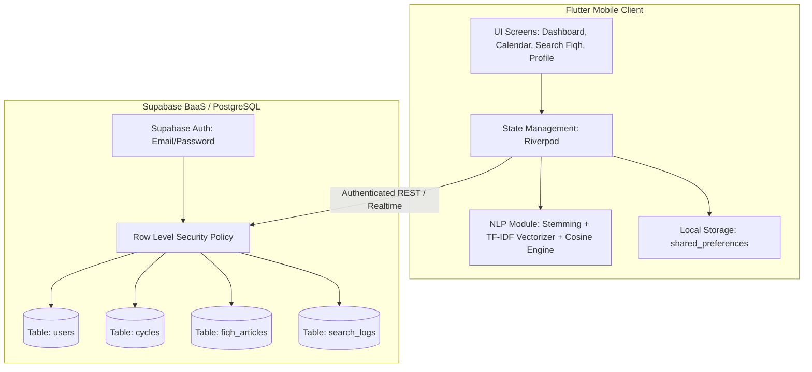
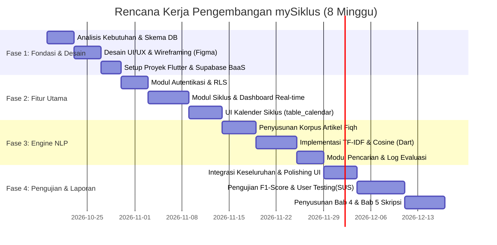

# Dokumen Analisis Kebutuhan & Rencana Kerja Pengembangan Aplikasi "mySiklus"
**Sub-judul:** Asisten Pencatatan Masa Suci dan Temu Kembali Informasi Panduan Hukum Darah Wanita Berbasis Flutter, Supabase, dan NLP  
**Konteks Proyek:** Tugas Akhir / Skripsi Semester 7 — Teknik Informatika / Sistem Informasi  
**Versi Dokumen:** 1.0  
**Tanggal:** Oktober 2026  

---

## 1. Eksekutif Ringkasan & Sintesis Analisis Dokumen

Berdasarkan telaah mendalam terhadap dokumen riset akademik (*"Analisis Literatur dan Identifikasi Kesenjangan Penelitian"*) dan dokumen teknis (*"Blueprint Aplikasi Mobile: mySiklus"*), proyek **mySiklus** hadir untuk memecahkan dikotomi kritis dalam ekosistem teknologi kesehatan reproduksi (*mHealth*):

1. **Aplikasi mHealth Komersial Global (Flo, Clue, MeetYou, Ovia):** Unggul dalam analitik big data dan antarmuka mutakhir, namun **buta secara epistemologis terhadap hukum Islam (Fiqh)**. Aplikasi ini hanya menghitung siklus fisiologis/endokrinologi murni tanpa mengakui entitas hukum peribadatan (keabsahan salat, puasa, thowaf, dan interaksi mushaf).
2. **Prototipe Akademik & Sistem Pakar Konvensional (Haidhee, Naïve Bayes, Forward Chaining):** Berupaya mengotomatisasi yurisprudensi agama, namun terjebak dalam **reduksionisme fatwa yang berbahaya secara teologis**. Algoritma deterministik biner memaksakan diri menjadi "Mufti Virtual" yang berisiko menyesatkan pengguna pada variasi siklus atau *edge-case* fisiologis individual (*adat*).
3. **Kekosongan Fungsional Masa Suci (*Purity Period*):** Aplikasi umum mendefinisikan waktu di luar haid sebagai fase pasif (folikular/ovulasi). Padahal dalam Fiqh, Masa Suci adalah **entitas aktif berlandaskan hukum syariat** dengan ambang batas minimal (15 hari dalam mazhab Syafi'i) yang menentukan kapan darah berikutnya sah diakui sebagai haid baru atau istihadhah.

### Paradigma Hibrida mySiklus
mySiklus memposisikan diri pada **titik ekuilibrium (keseimbangan)**:
* **Asisten Pencatat Empiris:** Mencatat data biologis dan durasi secara objektif, menolak menjatuhkan vonis hukum biner otomatis (*non-deterministic*).
* **Pustakawan Cerdas (*Smart Librarian*):** Menerapkan Sistem Temu Kembali Informasi (*Information Retrieval* / NLP) menggunakan pembobotan **TF-IDF** dan **Cosine Similarity** untuk menyajikan referensi literatur fiqh tervalidasi yang paling relevan dengan keluhan bahasa sehari-hari pengguna.
* **Privasi Tinggi & Desain Modern:** Mengadopsi arsitektur *Row Level Security* (RLS) Supabase dan *Design System* feminin elegan minimalis yang bebas dari kesan kaku purwarupa akademis terdahulu.

---

## 2. Matriks Analisis Kesenjangan & Strategi Resolusi Teknis

| Dimensi Kesenjangan | Kondisi Literatur / Eksisting | Bahaya / Kelemahan | Solusi Terapan di mySiklus |
| :--- | :--- | :--- | :--- |
| **Epistemologis & Etis** | Sistem Pakar Rule-Based / Naïve Bayes mengeluarkan klaim status otomatis. | Mengabaikan konsep dinamis *adat* wanita; vonis keliru membatalkan ibadah wajib. | Mengubah paradigma menjadi *Information Retrieval* (IR) & Triase Panduan; dilengkapi *ethical disclaimer*. |
| **Fungsionalitas Data** | Pelacak hanya fokus pada siklus pendarahan (*start date* s.d. *end date* haid). | Masa suci tidak tercatat sebagai entitas mandiri; pengguna ragu menghitung jeda suci 15 hari. | Menjadikan status masa suci sebagai entitas aktif mandiri dengan visualisasi *real-time counter*. |
| **Integrasi NLP & Time-Series** | NLP hanya diuji pada kotak pencarian statis fatwa/hadis web secara terpisah. | Anomali input siklus tidak terhubung dengan literatur hukum yang relevan. | Log harian dan pencarian teks terhubung; kueri keluhan memetakan artikel rujukan secara instan. |
| **Privasi & Antarmuka** | Prototipe kampus sering memiliki UI kaku, minim enkripsi, dan tanpa isolasi data aman. | Data siklus intim rentan bocor; adopsi pengguna rendah akibat *User Experience* (UX) yang buruk. | Implementasi Supabase RLS, enkripsi sesi lokal, serta *Design System* modern (*dusty rose*, *sage green*). |

---

## 3. Spesifikasi Arsitektur & Skema Basis Data

Sistem dibangun di atas arsitektur *Client-BaaS (Backend-as-a-Service)* menggunakan Flutter untuk aplikasi klien dan Supabase (PostgreSQL) sebagai penyedia autentikasi, basis data relasional, dan penyimpanan data terisolasi.



### 3.1. Rancangan Skema Basis Data Relasional (PostgreSQL DDL)

```sql
-- 1. TABEL PENGGUNA (Terkoneksi dengan Supabase Auth)
CREATE TABLE public.users (
    id UUID PRIMARY KEY REFERENCES auth.users(id) ON DELETE CASCADE,
    name VARCHAR(100) NOT NULL,
    email VARCHAR(150) UNIQUE NOT NULL,
    created_at TIMESTAMPTZ DEFAULT TIMEZONE('utc', NOW()) NOT NULL
);

-- Aktifkan Row Level Security
ALTER TABLE public.users ENABLE ROW LEVEL SECURITY;
CREATE POLICY "Users can only view and update their own profile"
    ON public.users FOR ALL
    USING (auth.uid() = id);

-- 2. TABEL SIKLUS (Pencatatan Haid dan Masa Suci)
CREATE TABLE public.cycles (
    id UUID PRIMARY KEY DEFAULT gen_random_uuid(),
    user_id UUID NOT NULL REFERENCES public.users(id) ON DELETE CASCADE,
    start_date DATE NOT NULL,
    end_date DATE NULL,
    duration_haid INT NULL,
    notes TEXT NULL,
    created_at TIMESTAMPTZ DEFAULT TIMEZONE('utc', NOW()) NOT NULL
);

ALTER TABLE public.cycles ENABLE ROW LEVEL SECURITY;
CREATE POLICY "Users can only manage their own cycles"
    ON public.cycles FOR ALL
    USING (auth.uid() = user_id);

-- 3. TABEL ARTIKEL FIQH (Basis Pengetahuan Terkurasi)
CREATE TABLE public.fiqh_articles (
    id UUID PRIMARY KEY DEFAULT gen_random_uuid(),
    title VARCHAR(255) NOT NULL,
    content TEXT NOT NULL,
    category VARCHAR(50) NOT NULL CHECK (category IN ('Haid', 'Nifas', 'Istihadah', 'Masa Suci', 'Ibadah')),
    search_keywords TEXT NOT NULL,
    reference VARCHAR(255) NOT NULL,
    author_reviewer VARCHAR(150) DEFAULT 'Tim Asatidz / Fiqh Reviewer',
    created_at TIMESTAMPTZ DEFAULT TIMEZONE('utc', NOW()) NOT NULL
);

ALTER TABLE public.fiqh_articles ENABLE ROW LEVEL SECURITY;
CREATE POLICY "Public read-only access for fiqh articles"
    ON public.fiqh_articles FOR SELECT
    TO authenticated
    USING (true);

-- 4. TABEL LOG PENCARIAN (Instrumen Riset Skripsi Bab 4)
CREATE TABLE public.search_logs (
    id UUID PRIMARY KEY DEFAULT gen_random_uuid(),
    user_id UUID NOT NULL REFERENCES public.users(id) ON DELETE CASCADE,
    search_query TEXT NOT NULL,
    matched_article_id UUID REFERENCES public.fiqh_articles(id) ON DELETE SET NULL,
    similarity_score REAL NOT NULL,
    created_at TIMESTAMPTZ DEFAULT TIMEZONE('utc', NOW()) NOT NULL
);

ALTER TABLE public.search_logs ENABLE ROW LEVEL SECURITY;
CREATE POLICY "Users can view and insert their own search logs"
    ON public.search_logs FOR ALL
    USING (auth.uid() = user_id);
```

---

## 4. Mekanisme & Alur Mesin Pencari Fiqh (TF-IDF & Cosine Similarity)

Untuk memastikan aplikasi tidak memberikan vonis status hukum secara absolut, pencarian artikel menggunakan pendekatan *Vector Space Model*:

1. **Text Preprocessing:**
   * **Case Folding:** Mengubah seluruh karakter menjadi huruf kecil (*lowercase*).
   * **Filtering / Punctuation Removal:** Menghilangkan tanda baca dan angka.
   * **Stopwords Removal:** Mengeliminasi kata sambung bahasa Indonesia umum (contoh: *dan*, *yang*, *di*, *ke*, *pada*).
   * **Stemming:** Reduksi kata ke bentuk dasar menggunakan algoritma Nazief & Adriani atau pustaka pemotong imbuhan Dart.
2. **Term Frequency - Inverse Document Frequency (TF-IDF):**
   $$\text{TF}(t, d) = \frac{f_{t,d}}{\sum_{t' \in d} f_{t',d}}$$
   $$\text{IDF}(t, D) = \log\left(\frac{1 + |D|}{1 + |\{d \in D : t \in d\}|}\right) + 1$$
   $$\text{Weight}(t, d) = \text{TF}(t, d) \times \text{IDF}(t, D)$$
3. **Kalkulasi Kemiripan Kosinus (Cosine Similarity):**
   $$\text{Cosine Similarity}(Q, D_i) = \frac{\vec{Q} \cdot \vec{D}_i}{\|\vec{Q}\| \|\vec{D}_i\|} = \frac{\sum_{k=1}^{n} w_{k,Q} \cdot w_{k,D_i}}{\sqrt{\sum_{k=1}^{n} (w_{k,Q})^2} \cdot \sqrt{\sum_{k=1}^{n} (w_{k,D_i})^2}}$$
4. **Peringkat Hasil (Ranking):**
   * Mengurutkan dokumen artikel dengan nilai *score* tertinggi.
   * Mengambil **Top-3 Artikel** teratas dan menyertakan rujukan kitab/dalil aslinya (misal: *Safinatun Najah*, *Fathul Qorib*, rujukan mazhab Syafi'i).

---

## 5. Rencana Kerja Pengembangan Aplikasi (Work Breakdown Structure / WBS)

Rencana kerja ini disusun dalam rentang **8 Minggu (Sprint Based)**, diselaraskan dengan kebutuhan penyusunan Laporan Skripsi Semester 7 (Bab 1 hingga Bab 5).



### Rincian Aktivitas Mingguan

#### Minggu 1: Analisis Kebutuhan, Riset Korpus, & Desain UI/UX
* **Target Output:** Dokumen spesifikasi kebutuhan, *Entity Relationship Diagram* (ERD), dan *High-Fidelity Design* di Figma.
* **Aktivitas:**
  1. Memvalidasi batasan fiqh darah wanita (Mazhab Syafi'i: batas minimal haid 24 jam, maksimal 15 hari, minimal suci 15 hari).
  2. Merancang palet warna desain (*Dusty Rose*: `#D88A8A`, *Sage Green*: `#8FA89B`, *Soft Mauve*: `#9B7E8C`, *Cream Background*: `#FDFBF7`).
  3. Menyusun komponen UI utama: Tombol Aksi Cepat ("Mulai Haid" / "Tandai Suci"), Kartu Status Harian, Kalender Siklus, Kotak Pencarian Fiqh.

#### Minggu 2: Konfigurasi Proyek & Backend Supabase
* **Target Output:** Lingkungan pengembangan terintegrasi, database live, dan autentikasi aktif.
* **Aktivitas:**
  1. Inisialisasi proyek Flutter (arsitektur berbasis fitur: `core`, `features/auth`, `features/cycle`, `features/fiqh`).
  2. Setup konfigurasi Supabase Client & Riverpod State Providers.
  3. Eksekusi migrasi skema tabel (`users`, `cycles`, `fiqh_articles`, `search_logs`) beserta kebijakan *Row Level Security* (RLS).
  4. Implementasi alur registrasi, login, dan manajemen sesi lokal via `shared_preferences`.

#### Minggu 3: Modul Pencatatan Siklus & Dashboard Real-Time
* **Target Output:** Fitur pencatatan haid dan masa suci berfungsi end-to-end.
* **Aktivitas:**
  1. Pembuatan logika tombol "Mulai Haid": mencatat `start_date` ke tabel `cycles`.
  2. Pembuatan logika tombol "Tandai Suci": memperbarui `end_date`, menghitung `duration_haid`, dan secara otomatis mengaktifkan penghitungan hari masa suci berjalan.
  3. Pengembangan komponen Dashboard yang menghitung selisih hari (*duration counter*) dengan *copywriting* netral: *"Kamu berada di Masa Suci Hari ke-X"*.
  4. Penyusunan validasi data input untuk mencegah tumpang tindih tanggal (*overlapping dates*).

#### Minggu 4: Visualisasi Kalender Riwayat & Modul Statistik
* **Target Output:** Tampilan kalender interaktif dan riwayat durasi siklus.
* **Aktivitas:**
  1. Integrasi paket `table_calendar` dengan *custom cell builder*.
  2. Pewarnaan visual kalender:
     * Merah Muda Lembut (*Dusty Rose*): Hari pendarahan haid tercatat.
     * Hijau Daun Lembut (*Sage Green*): Hari masa suci terkonfirmasi.
  3. Pembuatan layar riwayat siklus yang menampilkan daftar durasi haid bulan-bulan sebelumnya serta rata-rata siklus.

#### Minggu 5: Kurasi Basis Pengetahuan Fiqh & Tokenisasi Teks
* **Target Output:** Dataset 30–50 artikel fiqh terstruktur dan fungsi pra-pemrosesan teks.
* **Aktivitas:**
  1. Pengumpulan dan kurasi artikel fiqh dari kitab rujukan (*Safinatun Najah*, *Fathul Qorib*, buku fikih wanita standar pesantren) yang mencakup topik:
     * Tanda-tanda suci (*naqa'* dan *qashshah baidha'*).
     * Darah terputus-putus (*talfiq* vs *sahb*).
     * Batas maksimal 15 hari dan tata cara istihadhah.
     * Kewajiban mandi wajib dan qadha ibadah.
  2. Implementasi algoritma pembersihan teks (Case Folding, Regex Punctuation Stripper, Stopword Filter Indonesia, dan Stemmer).

#### Minggu 6: Implementasi Mesin Pencari NLP (TF-IDF & Cosine Similarity)
* **Target Output:** Mesin pencarian pintar yang merespons pertanyaan pengguna dan mencatat log.
* **Aktivitas:**
  1. Membuat kalkulator TF-IDF pembobotan kata terhadap korpus `fiqh_articles`.
  2. Membuat fungsi penghitung vektor kemiripan sudut kosinus (*Cosine Similarity*).
  3. Menampilkan Top-3 hasil artikel yang memiliki nilai kemiripan tertinggi, lengkap dengan kutipan referensi kitab.
  4. Menyimpan kueri pengguna, id artikel hasil pencocokan, dan *similarity score* ke dalam tabel `search_logs` untuk bahan analisis skripsi.

#### Minggu 7: Pengujian Sistem (Whitebox, Blackbox, & Uji Algoritma NLP)
* **Target Output:** Laporan metrik performa algoritma (Bab 4 Skripsi).
* **Aktivitas:**
  1. **Pengujian Fungsional (Blackbox Testing):** Memvalidasi seluruh alur tombol, kalender, dan autentikasi.
  2. **Pengujian Algoritma NLP:**
     * Menyiapkan 20 skenario kueri uji berbahasa sehari-hari (contoh: *"darah keluar lagi setelah suci 3 hari"*, *"flek cokelat sebelum haid"*, *"lupa mandi wajib"*).
     * Menghitung nilai **Precision, Recall, dan F1-Score** terhadap relevansi dokumen yang dihasilkan.
  3. Penanganan *edge case* kueri tanpa kecocokan kata (*zero vector handling*): menampilkan rekomendasi artikel populer dan saran konsultasi ke ustadzah/ahli fiqh.

#### Minggu 8: Uji Akseptansi Pengguna (SUS) & Finalisasi Skripsi
* **Target Output:** Hasil evaluasi *System Usability Scale* (SUS) dan aplikasi siap sidang.
* **Aktivitas:**
  1. Pengujian pengguna kepada 20–30 responden muslimah menggunakan kuesioner standar SUS (10 pertanyaan skala Likert).
  2. Analisis skor SUS untuk mengukur kemudahan antarmuka dan kepuasan pengguna.
  3. Penyusunan laporan Bab 4 (Hasil dan Pembahasan) dan Bab 5 (Kesimpulan dan Saran).
  4. Pembuatan build rilis APK Android / iOS via Flutter.

---

## 6. Rancangan Metodologi Evaluasi Akademik (Untuk Skripsi Bab 4)

Dokumen analisis menekankan pentingnya pengujian kuantitatif yang solid agar skripsi memiliki kontribusi ilmiah yang kuat:

### 6.1. Evaluasi Kinerja Information Retrieval (NLP)
Menggunakan matriks Confusion Matrix standar pencarian teks:
* **Precision ($P$):**
  $$P = \frac{\text{Artikel Relevan Terpilih}}{\text{Total Artikel yang Dihasilkan Mesin}}$$
* **Recall ($R$):**
  $$R = \frac{\text{Artikel Relevan Terpilih}}{\text{Total Seluruh Artikel Relevan di Basis Data}}$$
* **F1-Score:**
  $$F_1 = 2 \times \frac{P \times R}{P + R}$$

*Target Capaian:* Menghasilkan $F_1 \ge 0.70$ untuk kueri bahasa alami non-formal.

### 6.2. Evaluasi Pengalaman Pengguna (System Usability Scale / SUS)
Menggunakan 10 instrumen pertanyaan baku SUS yang dikonversi ke skala 0–100:
$$\text{Score SUS} = \left[ \sum (\text{Skor Ganjil} - 1) + \sum (5 - \text{Skor Genap}) \right] \times 2.5$$
*Target Capaian:* Nilai SUS di atas **75 (Kategori "Good" / "Acceptable")**, membuktikan bahwa mySiklus berhasil mengatasi masalah antarmuka kaku dari purwarupa terdahulu.

---

## 7. Rencana Mitigasi Risiko

1. **Risiko Salah Tafsir Hukum Agama:**
   * *Mitigasi:* Seluruh hasil pencarian wajib disertai teks *disclaimer* baku: *"Aplikasi ini berfungsi sebagai media literasi dan bukan pengganti fatwa ulama. Untuk kasus darah yang kompleks, disarankan berkonsultasi langsung dengan ahli fiqh wanita terpercaya."*
2. **Kueri NLP Tidak Menemukan Dokumen (*Zero Match*):**
   * *Mitigasi:* Jika nilai kemiripan tertinggi kosinus bernilai 0 atau di bawah ambang batas (*threshold* 0.15), sistem secara anggun menampilkan pesan: *"Topik belum ditemukan secara spesifik. Berikut artikel dasar seputar haid dan istihadhah yang mungkin membantu."*
3. **Privasi & Kebocoran Data Siklus:**
   * *Mitigasi:* Seluruh kueri ke Supabase wajib menyertakan token JWT autentikasi dengan RLS aktif. Kueri pencarian di `search_logs` disamarkan (*anonymized*) saat diekspor untuk lampiran skripsi.

---

## 8. Rekomendasi Langkah Eksekusi Selanjutnya

1. **Tahap 1:** Tinjau dan sepakati pembagian fitur pada dokumen ini.
2. **Tahap 2:** Buat inisialisasi struktur folder proyek Flutter di dalam folder kerja `mySiklus`.
3. **Tahap 3:** Konfigurasi proyek Supabase (tabel dan RLS) sesuai skrip SQL di atas.
4. **Tahap 4:** Mulai implementasi kode modul demi modul sesuai timeline WBS 8 minggu.
